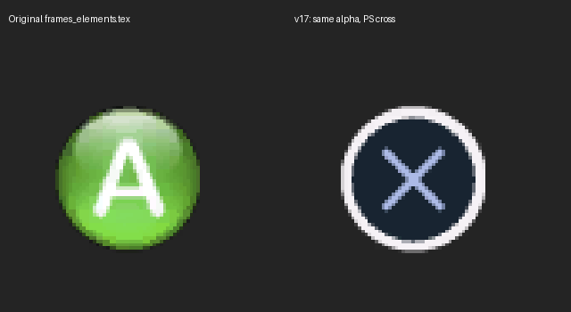

# Fable II Recompiled — ПК-версия Fable 2 (форк deadtools)

Нативный порт **Fable 2** (Xbox 360, Title ID `4D5307F1`) на Windows, созданный статической рекомпиляцией на [ReXGlue SDK](https://github.com/rexglue/rexglue-sdk) v0.10.0. Код игры для PowerPC при сборке переводится в C++ (`rexglue codegen` по манифесту `fable_2_manifest.toml`), эмулятора нет.

> **Это форк** проекта [himdo/Fable-2-Recomp](https://github.com/himdo/Fable-2-Recomp) (версия 1.5.0).
> Автор оригинального проекта — **Himdo**. Доработки лаунчера (1.6.x) — [deadtools](https://github.com/deadtools). Лицензия MIT сохранена, см. [LICENSE](LICENSE).

> ⚠️ **Проект не поддерживает пиратство.** Игровые файлы в репозитории не распространяются — нужен ваш собственный образ диска. Любые упоминания или ссылки на пиратские копии приводят к удалению и бану.

**Содержание:** [Установка и запуск](#-установка-и-запуск) · [Что нового в форке](#-что-нового-в-форке-лаунчер-16x) · [Возможности](#возможности) · [Лаунчер](#лаунчер) · [Управление](#управление-клавиатура-и-мышь) · [Настройки](#пользовательские-настройки-fable2_configtoml) · [Для разработчиков](#для-разработчиков)

---

## 🚀 Установка и запуск

> **Главное, что нужно понять:** лаунчер — это только окно настроек. Сама игра — это `fable_2.exe` и DLL-файлы рядом с ним. Лаунчер должен лежать **в той же папке**, что и `fable_2.exe`, и запускаться **оттуда**.

### Что понадобится
- Windows 10/11, 64 бита, видеокарта с поддержкой DirectX 12.
- **Свой** ISO-образ Fable II **Game of the Year** (поддерживаемые версии — ниже).
- [.NET 8 SDK](https://dotnet.microsoft.com/download/dotnet/8.0) (раздел SDK → Windows x64) — только чтобы собрать лаунчер 1.6.x.

### ⚠️ Правило №1: правильная папка
Папку с игрой создавайте по пути **только из латинских букв** и **не в облачной папке**:

| ✅ Можно | ❌ Нельзя |
|---|---|
| `D:\Games\Fable2` | `D:\Игры\Fable2` (кириллица) |
| `C:\Fable2` | `Y:\YandexDisk\Софт\Fable2` (кириллица + облако) |
| `E:\Games\Fable 2` (пробелы допустимы) | `C:\Users\Имя\OneDrive\...` (облако) |

Иначе игра покажет ошибку *«The data folder was not found»*, даже если папка `data` на месте.

### Шаг 1. Готовая игра (один раз)
1. Откройте релиз оригинала: **https://github.com/himdo/Fable-2-Recomp/releases/tag/1.5.0**
2. В блоке **Assets** скачайте архив с готовой сборкой (**не** «Source code» — там только исходники).
3. Распакуйте его в папку игры, например `D:\Games\Fable2`. Внутри должны быть `fable_2.exe`, `rexruntime.dll`, `rexgpu-xenos.dll` и `Fable2Launcher.exe`.

### Шаг 2. Лаунчер 1.6.x из этого репозитория
1. На этой странице нажмите **Code → Download ZIP** и распакуйте архив **в отдельную папку**, например `D:\Games\Fable2-Source`.
2. Запустите `BUILD-LAUNCHER-LOCAL.cmd` и дождитесь надписи об успешной сборке.
3. Возьмите файл `D:\Games\Fable2-Source\out\texture-diagnostics-launcher\Fable2Launcher.exe`
   и скопируйте его в папку игры (`D:\Games\Fable2`) **с заменой**.

> Шаг 2 можно пропустить — тогда будет оригинальный лаунчер 1.5.0 без русского языка, DualShock и регулировки скорости.

### Шаг 3. Файлы игры из ISO (один раз)
1. Запустите `Fable2Launcher.exe` **из папки игры** (не из `out`!).
2. Нажмите **«Извлечь из ISO»** (*Extract from ISO*) и выберите свой образ.
3. Лаунчер проверит версию игры и распакует файлы. После этого рядом с `fable_2.exe` должны появиться `default.xex` и папка `data`.

### Шаг 4. Запуск
1. Скорость игры оставьте **1,0×** (другие значения требуют пересобранного `fable_2.exe`, см. [Скорость игры](#скорость-игры)).
2. Нажмите **«Запустить игру»**. Лаунчер закроется, игра откроется.

В дальнейшем запускайте игру **только** через `Fable2Launcher.exe` в папке игры.

### Как должна выглядеть папка игры
```
D:\Games\Fable2\
├─ Fable2Launcher.exe        ← лаунчер 1.6.x (из этого репозитория)
├─ fable_2.exe               ← игра (релиз himdo 1.5.0)
├─ rexruntime.dll            ← (релиз himdo 1.5.0)
├─ rexgpu-xenos.dll          ← (релиз himdo 1.5.0)
├─ default.xex               ← извлечено из ISO
├─ data\                     ← извлечено из ISO
├─ saves\                    ← ваши сохранения (появится после первой игры)
├─ fable_2.toml              ← настройки графики (пишет лаунчер)
└─ fable2_config.toml        ← пользовательские настройки игры
```

### Поддерживаемые версии игры
Fable II **GOTY**: США/Европа (основная), Германия, Франция, Италия, Россия, Испания.
Не поддерживаются: немецкая retail/TU1, японская, азиатская и латиноамериканская версии.
Образ, с которого начинался проект (GOTY USA/EU), SHA-256:
`685a0d3bea9718812f17bcd155907a5359a548b6d3d8342dd2a6c944f45e35ff`

### Сохранения
Сохранения лежат в папке `saves` рядом с `fable_2.exe`. Чтобы не потерять прогресс, делайте её копию; чтобы перенести игру на другой ПК — скопируйте эту папку.

### Если не запускается

| Что видите | Причина и решение |
|---|---|
| `The data folder was not found in …` | В пути есть русские буквы или папка в облаке. Перенесите папку игры (см. Правило №1). Проверьте, что папка `data` существует — иначе снова «Извлечь из ISO». |
| `default.xex was not found next to fable_2.exe` | Лаунчер запущен не из папки игры, или ISO не распакован. |
| Ошибка хэша / `Incomplete or mixed GOTY content` | Образ неподдерживаемой версии или повреждён. Используйте поддерживаемую GOTY-версию. |
| «Для скорости отличной от 1,0× нужен новый fable_2.exe» | Верните скорость **1,0×**. |
| «Файл fable_2.exe не найден рядом с лаунчером» | Лаунчер лежит не в папке игры — см. шаг 2.3. |
| Лаунчер не открывается | Откройте `%LOCALAPPDATA%\Fable2Launcher\launcher-startup-error.log` (вставьте путь в адресную строку Проводника). Вернуть прежний лаунчер — `RESTORE-LAUNCHER-BACKUP.cmd`. |
| Игра закрылась с кодом ошибки | Включите в лаунчере диагностический запуск — он сохранит отчёт в папку `diagnostics`. Приложите его к вопросу в [Issues](https://github.com/deadtools/-Fable-2-Recomp/issues). |
| Чёрные текстуры героя и собаки | В «Расширенных настройках» выберите режим текстур «Морфинг на GPU в реальном времени» или «Совместимый Readback». |

<details>
<summary><b>English — quick start</b></summary>

1. Use a game folder with **Latin-only characters, outside cloud-synced folders** (e.g. `D:\Games\Fable2`). Non-Latin characters in the path cause *"The data folder was not found"*.
2. Download himdo's prebuilt **1.5.0** release (Assets, not "Source code") and extract it there.
3. Download this repo (**Code → Download ZIP**), run `BUILD-LAUNCHER-LOCAL.cmd` (needs .NET 8 SDK), copy `out\texture-diagnostics-launcher\Fable2Launcher.exe` into the game folder, replacing the old one.
4. Run the launcher **from the game folder** → **Extract from ISO** → pick your own ISO. `default.xex` and `data\` appear next to `fable_2.exe`.
5. Keep game speed at **1.0×** and press **Launch**. The launcher has an EN/RU switch in the top-right corner.

</details>

---

## ✨ Что нового в форке (лаунчер 1.6.x)

- 🌐 **Переключатель языка EN / RU** — кнопка в правом верхнем углу лаунчера. Интерфейс полностью переведён на русский: главная страница, «Расширенные настройки», статусы, извлечение из ISO, настройки GPU и текстур, подсказки и сообщения об ошибках. Язык меняется сразу, без перезапуска, и запоминается (`%LOCALAPPDATA%\Fable2Launcher\launcher-language.txt`). По умолчанию — английский. Язык самой игры не меняется.
- 🎮 **Переключение Xbox ↔ PlayStation (DualShock)** — галочка «Использовать геймпад DualShock» в «Расширенных настройках» меняет все экранные подсказки на стиль PlayStation: A→✕, B→○, X→□, Y→△, LB→L1, RB→R1, LT→L2, RT→R2 (подсказки, иконки меню, HUD). При первом включении создаётся резервная копия `gui_textures.bnk`; снятие галочки возвращает исходные иконки. Подробнее: [DUALSHOCK_PROMPTS_RU.md](DUALSHOCK_PROMPTS_RU.md).
- 🧍 **Режимы текстур героя и собаки** — выбор: морфинг на GPU в реальном времени (по умолчанию), совместимый Readback или диагностический режим. Плюс локальный диагностический отчёт о запуске (`diagnostics\session-…`) — ничего никуда не отправляется.
- ⏱ **Скорость игры 0,1–2,0×** (шаг 0,1, по умолчанию 1,0×) — см. [Скорость игры](#скорость-игры).
- 🛟 **Надёжный запуск лаунчера** — ошибки старта пишутся в `launcher-startup-error.log`; `RESTORE-LAUNCHER-BACKUP.cmd` возвращает предыдущий `Fable2Launcher.exe`.



Описание версий: [docs/releases](docs/releases).

### Скорость игры
Ползунок в лаунчере задаёт скорость игрового времени от 0,1× до 2,0×. При значении 1,0× игра работает как в оригинале. Для любого другого значения нужен `fable_2.exe`, собранный из исходников этого форка (скрипт `BUILD-GAME-SPEED-LOCAL.cmd` будет добавлен в репозиторий позже) — готовая сборка himdo 1.5.0 поддерживает только 1,0×, и лаунчер предупредит об этом. Технические подробности: [docs/GAME_SPEED_V18.md](docs/GAME_SPEED_V18.md).

---

## Возможности

- [x] Игру можно пройти полностью
- [x] Сундук гильдии полностью разблокирован
- [x] Снятое ограничение / повышенная частота кадров
- [x] Повышенное разрешение (внутренний рендеринг до 5K)
- [x] Встроенное отладочное меню
  - [x] Запуск собственных Lua-скриптов в игре (F5)
- [x] Клавиатура и мышь
- [ ] Внутриигровые подсказки под клавиатуру и мышь
  - [ ] Автоматическое переключение подсказок
- [x] Подсказки PlayStation (DualShock) — *форк*
- [x] Исправление чёрных текстур героя и собаки (с выбором режима — *форк*)
- [x] Регулировка скорости игры — *форк*
- [ ] Дальнейший рост производительности
- [ ] Vulkan (в работе)
- [ ] Сборки для Linux
- [x] Команды для отладки
- [ ] Улучшенная графика
- [ ] Свои меню / доработка меню (например, выход из игры)
- [x] Другие языки игры: Германия, Франция, Италия, Россия, Испания
- [x] Собственный лаунчер
  - [x] Встроенное извлечение из ISO
  - [x] Русский интерфейс и переключатель EN/RU — *форк*

---

## Лаунчер

Лаунчер (WPF, .NET 8) определяет версию игры и настраивает:
- разрешение вывода и внутренний масштаб рендеринга, анизотропную фильтрацию, FXAA, VSync;
- оконный / полноэкранный режим и ограничение FPS (30/60/120/144/165/240/без ограничения);
- в **«Расширенных настройках»** — раскладку клавиатуры, патчи (предметы с сайта, коллекционное издание, пропуск заставок, повышенная частота тиков, отключение размытия в движении), режим текстур героя и собаки, DualShock.

Настройки лаунчера хранятся в `launcher-settings.toml`, настройки графики записываются в `fable_2.toml` (остальные параметры сохраняются, перед первой записью делается резервная копия).

**Извлечение из ISO.** Кнопка «Извлечь из ISO» открывает образ `.iso`, сначала достаёт только `default.xex`, проверяет его SHA-256 по списку поддерживаемых версий и лишь затем распаковывает остальное (`default.xex` и `data\`) в папку лаунчера — с индикатором прогресса и кнопкой «Стоп». Используется библиотека [X360Extract](tools/x360extract/), результат совпадает с утилитой `x360extract` побайтно.

Альтернатива — сторонняя программа [XboxImageExtractor](https://github.com/dromex1/XboxImageExtractor): откройте в ней образ и извлеките `default.xex` и папку `data` в папку игры.

Папка игры по умолчанию — папка самого лаунчера; выбранный путь запоминается.

### Параметры командной строки `fable_2.exe`

| Параметр | Что делает |
|---|---|
| `--game_data_root <путь>` | Брать файлы игры из другой папки (сохранения и кэш всё равно остаются рядом с exe) |
| `--update_data_root <путь>` | Необязательная папка с обновлением |
| `--window_width` / `--window_height` / `--fullscreen` | Параметры окна |
| `--keyboard_gamepad_map <раскладка>` | Раскладка клавиатуры → кнопки геймпада (см. ниже) |
| `--skipHash` | Не проверять SHA-256 `default.xex` (хэш пишется в лог, но несовпадение не блокирует запуск) — для изменённых или неизвестных XEX |

---

## Управление: клавиатура и мышь

Игра читает геймпад Xbox 360 (`XamInputGetState`). Поверх обычного драйвера SDL добавлен «клавиатурный геймпад» (`src/input/keyboard_gamepad.h`): клавиши и кнопки мыши **добавляются** к нажатиям реального геймпада, который продолжает работать.

Раскладка по умолчанию:

| Клавиша | Кнопка геймпада |
|---|---|
| ЛКМ | `X` |
| ПКМ | `Y` |
| СКМ / `B` | `B` |
| `Shift` / `E` | `A` |
| `W` `A` `S` `D` | Левый стик (вперёд / влево / назад / вправо) |
| `Q` / `R` | Левый / правый триггер |
| `Z` / `Tab` | Левый / правый бампер |
| Стрелки | Крестовина |
| `Esc` | Пауза (Start) |
| `M` | Select (Back) |

**Своя раскладка** задаётся параметром `keyboard_gamepad_map` в формате `Клавиша:Кнопка,Клавиша:Кнопка,...` — постоянно в `[input]` файла `fable2_config.toml`, или разово:
```
fable_2.exe --keyboard_gamepad_map "E:A,B:B,Space:L3,Enter:Start"
```
- **Клавиша** — имя клавиши (`E`, `Space`, `LeftShift`, `F1`, …) или кнопка мыши: `LMB`, `RMB`, `MMB`, `XMB1`/`XMB2` (боковые).
- **Кнопка** — `A`, `B`, `X`, `Y`, `LB`/`RB`, `LT`/`RT`, `Up`/`Down`/`Left`/`Right`, `Pause`, `Select`, `L3`/`R3`, `StickUp`/`StickDown`/`StickLeft`/`StickRight` (левый стик).

### Обзор мышью (правый стик)
Движение мыши управляет камерой (правый стик): ведёте мышь — камера поворачивается, останавливаете — останавливается.

| Параметр | Что делает |
|---|---|
| `--mouse_look <bool>` | Включить/выключить обзор мышью (по умолчанию `true`) |
| `--mouse_look_scale <n>` | Чувствительность (по умолчанию `256`; больше — чувствительнее) |

Значения по умолчанию — в `[input]` файла `fable2_config.toml`. Все эти параметры можно менять прямо в игре через консоль (F3).

### F5 — запуск своего Lua-скрипта
Клавиша **F5** выполняет внешний Lua-файл в игровом Lua-окружении (как встроенная функция игры `RunScript(path)`). Доступен весь API игры (`QuestManager`, `Debug`, `GUI`, `Creature`, `Player`, …), файл перечитывается при каждом нажатии — его можно править на лету.
- Файл по умолчанию: `data/scripts/recomp/F5.lua` (показывает координаты героя X/Y/Z).
- Путь задаётся параметром `f5_lua_path` (относительно `data/`), например `fable_2.exe --f5_lua_path "scripts/other/MyScript.lua"`.
- Реализация: `src/input/keyboard_gamepad.h`, `src/diagnostics/fps_meter.h`, `src/core/fable2_f5_lua.h`.

---

## Пользовательские настройки (`fable2_config.toml`)

Файл рядом с exe; не путать с `fable_2.toml` (параметры SDK, их пишет лаунчер). Если файла нет, игра создаст его с настройками по умолчанию.

- Отсутствующие ключи → значения по умолчанию; неверные типы / неизвестные секции → предупреждение в логе; синтаксическая ошибка → сообщение и значения по умолчанию (запуск не блокируется).
- `[input]` — `keyboard_gamepad_map`, `mouse_look`, `mouse_look_scale`. Применяются при старте, только если не заданы с более высоким приоритетом (`fable_2.toml`, переменные `REX_*`, командная строка); консоль F3 может менять их на лету.
- `[patches]` — переключатели патчей рекомпиляции, проверяются при каждом вызове: переключили, перезапустили — пересборка не нужна. Включая `high_tick_rate` и `higher_hf_tick_rate` (режимы Xenia «High Tick Rate» / «Higher HF Tick Rate», включайте вместе).
- Скорость игры и режим текстур героя/собаки тоже хранятся здесь — их выставляет лаунчер.

---

## Для разработчиков

### Сборка лаунчера
`BUILD-LAUNCHER-LOCAL.cmd` — проверка компиляции, тесты и сборка лаунчера (.NET 8 SDK); игру не пересобирает и файлы игры не трогает. Результат: `out\texture-diagnostics-launcher\Fable2Launcher.exe`. Флаг `--build-only` — для вызова из общих скриптов.

### Сборка игры (`fable_2.exe`)
Всё необходимое есть в репозитории или скачивается автоматически — **без жёстко прописанных путей**. Нужны:
- **CMake** ≥ 3.25 (в PATH);
- **LLVM** (clang/clang++/lld) — в PATH или в `C:\Program Files\LLVM`;
- **Ninja** (в PATH, `%USERPROFILE%\bin` или папке пакетов WinGet);
- **интернет** при первой сборке — `build.cmd` скачает готовый ReXGlue SDK v0.10.0 (~100 МБ) с [официального релиза](https://github.com/rexglue/rexglue-sdk/releases/tag/v0.10.0) в `out\tooling\rexglue-sdk-0.10.0\`;
- **Python и Git**; **Visual Studio Build Tools / Windows SDK** (x64).
- **Файлы игры** (`default.xex` и `data\`) в корне проекта — нужны для генерации кода, в репозиторий не публикуются.

```
build.cmd               # настройка + fable_2_codegen (rexglue codegen по манифесту)
build.cmd fable_2       # настройка + сборка игры целиком
build.cmd <цель>        # любая другая цель CMake
build.cmd -release [t]  # сборка Release (-O3) вместо Debug (короткая форма: -r)
```

- По умолчанию — пресет `win-amd64-debug` (`-O0`, `out\build\win-amd64-debug`). **Debug-сборка в игре очень медленная** — для игры используйте `-release` (`out\build\win-amd64-release`). Release кладёт рядом `rexruntime.dll` и `rexgpu-xenos.dll`, Debug — `rexruntimed.dll` и `rexgpu-xenosd.dll`.
- Компилятор — только clang (заголовки SDK используют `__builtin_bswap32`, `__VA_OPT__`); пресет `win-msvc-debug` работает лишь для целей без `generated/`.
- Генерация кода перезапускается сама при изменении `fable_2_manifest.toml` или `default.xex`. Полная сборка — ~291 файл, 60 462 функции.
- Обе конфигурации собирают закреплённый и пропатченный SDK из исходников, см. [docs/RUNTIME_FIXES.md](docs/RUNTIME_FIXES.md).
- Правки SDK для скорости игры вносит скрипт `tools/prepare_game_speed_sdk.py` при сборке рантайма (`tools/build_runtime_sdk.cmd`); сабмодуль `thirdparty/rexglue-sdk` не изменён.

Ручная настройка (обычно не нужна):
```
tools\setup_sdk.cmd      # только скачать готовый SDK (это делает build.cmd)
tools\setup_sdk_src.cmd  # исходники SDK для Vulkan: клон rexglue/rexglue-sdk на
                         # закреплённом коммите (f5337cdc), сабмодули по
                         # thirdparty/rexglue-sdk-submodule-pins.txt и патч
                         # thirdparty/rexglue-sdk-local.patch. ДОЛГО (несколько ГБ)
```
Свой путь к SDK: `cmake -DREXGLUE_SDK_ROOT=<готовый SDK> -DREXGLUE_SDK_SOURCE=<исходники SDK>`.

### Патчи образа игры
Патчи данных загруженного `default.xex` (операции game-patches Xenia) применяются до запуска модуля: `Fable2App::OnPostLoadXexImage()` → `fable2::patches::ApplyAll()` (`src/core/fable2_patches.{h,cpp}`). Отдельного файла патчей нет — каждый включается ключом в `[patches]` файла `fable2_config.toml`. **Только данные**: операции над кодом здесь бессмысленны (гостевой `.text` не исполняется), патчи кода делаются mid-asm хуками. Подробнее: `docs/patches.md`.

### Трассировка вызовов функций (`fable2_func_trace.log`)
Каждый вход в гостевую функцию может логироваться по имени: codegen ставит `REX_FUNC_PROLOGUE()` в начало каждой функции, сборка перехватывает этот макрос через `src/core/fable2_func_trace.h` (сгенерированные файлы не меняются). Повторные вызовы сжимаются (`sub_82189708 x 4821`). Сводка по количеству вызовов пишется в `fable2_func_summary.log` каждые 5 с и при выходе.

По умолчанию выключено. Включение:
```
set FABLE2_FUNC_TRACE=1                      rem все входы в функции
set FABLE2_FUNC_TRACE_FILTER=LoadingScreen   rem только имена с этой подстрокой
set FABLE2_FUNC_TRACE_LOG=0                  rem без подробного лога (только сводка)
set FABLE2_FUNC_TRACE_SUMMARY=0              rem без сводки (только лог)
set FABLE2_FUNC_TRACE_SUBS_ONLY=1            rem только безымянные sub_<hex> — для поиска, что назвать дальше
```
Или из кода: `Fable2FuncTraceSetEnabled`, `…SetFilter`, `…SetSubsOnly`, `…SetLogEnabled`, `…SetSummaryEnabled`, `Fable2FuncTraceFlush` (`extern "C"` в `src/core/fable2_func_trace.h`).

Обёртка `fable2-functrace.cmd` (лежит рядом с exe) выставляет переменные и сохраняет прошлый лог как `fable2_func_trace_prev.log`:
```
fable2-functrace.cmd                      D3D12, все вызовы
fable2-functrace.cmd vulkan               Vulkan, все вызовы
fable2-functrace.cmd subs LoadingScreen   только sub_<hex> + фильтр
fable2-functrace.cmd summary              только сводка (дёшево для долгих сессий)
```
Удалить функцию: блок `target_precompile_headers` в `CMakeLists.txt` + `src/core/fable2_func_trace.h`.

### Удалённое управление (автоматизированный ввод)
**Только в Debug-сборках** (макрос `FABLE2_REMOTE_CONTROL`): `fable_2.exe` поднимает локальный TCP-сервер (`127.0.0.1:8791`), через который внешний скрипт управляет гостевым геймпадом JSON-сообщениями (по одному объекту на строку). Ввод складывается с реальными устройствами и работает, даже когда окно игры не в фокусе. Описание: `plans/ai-remote-input-control.md`.

```
python tools\fable2_control.py ping
python tools\fable2_control.py press A --hold 120
python tools\fable2_control.py get-state
python tools\fable2_control.py game-state
python tools\fable2_control.py screenshot shots/after_jump.png
python tools\fable2_control.py script --file repro.json
```
Команды: `ping`, `info`, `auth`, `press`, `release`, `stick`, `state`, `clear`, `script` (атомарная последовательность с задержками `delay_ms` между шагами), `get_state`, `game_state` (`PreMainMenu` / `PressAScreen` / `MainMenuMovie` / `MainMenu`), `screenshot` (PNG текущего кадра прямо из текстуры рендерера, 1280×720), `cvar`, `enable`/`disable`. `hold_ms` ≤ 0 — держать до отпускания.

Настройки — секция `[remote]` в `fable2_config.toml`: `enabled`, `host` (`0.0.0.0` открывает доступ со всех интерфейсов), `port` (если занят — пробуются +1…+9), `token` (если задан, первая строка соединения — `{"cmd":"auth","token":"..."}`). Все команды пишутся в `logs/`.

### Vulkan (в работе)
Готовый GPU-плагин SDK для Windows содержит только D3D12. Поэтому SDK собирается из исходников с `REXGLUE_USE_VULKAN=ON` и локальным патчем проекта, а рендерер выбирается при запуске без пересборки игры:
```
tools\build_sdk_vulkan.cmd                       # собрать Vulkan-плагин
build.cmd -release fable_2_vulkan_smoke          # проверочное окно Vulkan
fable_2.exe --gpu_plugin=xenos                   # D3D12 (по умолчанию)
fable_2.exe --gpu_plugin=xenos-vulkan            # Vulkan (только Release)
```
- Этап 1 (готово): своё Vulkan-окно через `rex::ui` из общего `rexruntime.dll` (сырые Win32/статический SDL здесь не работают); нужен `NOMINMAX`; image view свопчейна должны жить дольше фреймбуферов. Заголовки Khronos — `thirdparty/vulkan`, `thirdparty/vk_video` (Vulkan 1.3.282).
- Этап 2 (в работе): рендеринг игры через Vulkan-бэкенд SDK. Локальные изменения SDK — `thirdparty/rexglue-sdk-local.patch` (исправление вылета в главном меню и инструментирование), см. `docs/main_menu_crash_fix.md`.

### Манифест (`fable_2_manifest.toml`)
Перенесён из конфигурации XenonRecomp (`XenonRecomp/fable2.toml`):
- 87 ручных границ функций; пересекающиеся границы, которые ReXGlue запрещает, исправлены (исходные размеры — в комментариях).
- 13 «затравочных» входов функций для переходов, которые автоанализ не нашёл (цепочка 8-байтовых thunk'ов `0x82C000F0`–`0x82C00128` и др.).
- `setjmp_address = 0x83000200`, `longjmp_address = 0x82CA9260`, два пропуска таблиц данных в `[[invalid_instructions]]`.
- Известный риск: несколько некритичных предупреждений «Unresolved conditional branch» (`0x82C8D408`, `0x82C99E74`, `0x82C9A0BC`) — если эти пути выполнятся, сработает `REX_FATAL`.

### Правило именования функций (важно)
Имя `name` в манифесте становится C-символом `__imp__<name>`. Оно **не должно совпадать** с экспортом XAPI из `rexruntime(d).dll`, иначе локальная функция молча перекроет импорт DLL и вызовы ядра пойдут в гостевую функцию. Так однажды сломался звук: обёртки `KeWaitForSingleObject` / `KeWaitForMultipleObjects` получили суффикс `_Guest` именно поэтому. Проверка перед коммитом:
```
python tools/check_manifest_collisions.py
```

---

## Авторы и история
- **Himdo** — автор проекта. Проект начинался как проверка возможностей локальных open-source ИИ (Qwen3.8 27B запустил игру примерно за час), дальше — много ручной работы по разметке функций, достаточной для полного прохождения игры. Участники оригинала: Locme, ChrisF999 и другие — см. [историю коммитов](https://github.com/deadtools/-Fable-2-Recomp/commits/main).
- **deadtools** — лаунчер 1.6.x: русский интерфейс и EN/RU, DualShock, режимы текстур, скорость игры, диагностика.

Лицензия: [MIT](LICENSE) © 2026 Himdo.
